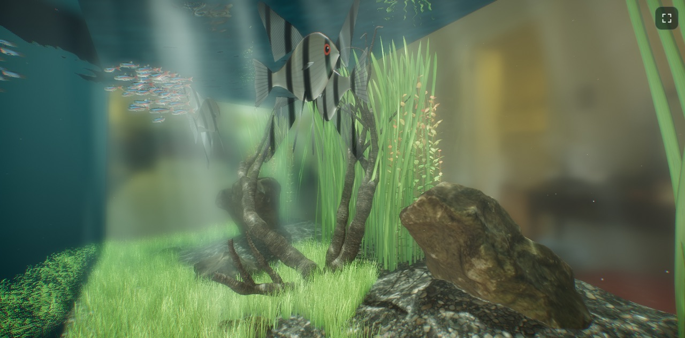

# Aquarium

A first-person aquarium in the browser: you are a small fish in a planted tank.

**▶ Play: https://pravbeseda.github.io/aquarium/**



Swim through Vallisneria, hairgrass and Rotala that part around you, past driftwood and mossy stones, with a school of neon tetras and a few angelfish. Flakes drop in from time to time — catch them before the neons do. Above you is the underside of the water surface with the lamp in Snell's window; through the glass you see the room outside, out of focus.

## Controls

**Desktop** — click *Dive in*, then:

| Action | Keys |
| --- | --- |
| Swim | `W` `A` `S` `D` or arrow keys |
| Look around | mouse |
| Up / down | `Space` / `C` (also `E` / `Q`) |
| Faster | `Shift` |
| Fullscreen | `F` or the button in the corner |
| Pause | `Esc` |

**Phone and tablet** — the left thumb swims with a floating joystick (push it past the rim to dash), the right thumb looks around. The button in the corner switches to fullscreen; on iPhone, use *Share → Add to Home Screen* to run it fullscreen.

The game picks a quality level for the device and adjusts its render resolution to keep the frame rate up. It needs a browser with WebGL 2.

## Running locally

```sh
npm install
npm run dev        # add `-- --host` to open it from a phone on the same Wi-Fi
npm test
npm run build      # typecheck and build into dist/
```

Handy URL parameters while developing: `?quality=low|medium|high`, `?autostart`, `?cam=x,y,z,yaw,pitch`, `?touch`, `?stats`.

Built with [three.js](https://threejs.org/), Vite and TypeScript. Pushes to `main` deploy to GitHub Pages.

## Credits

The living-room HDRI (`lythwood_room`), the mossy rocks (`rock_moss_set_01`) and the gravel and bark textures (`ganges_river_pebbles`, `bark_willow_02`) are from [Poly Haven](https://polyhaven.com/), released under CC0. Plants, fish, driftwood, caustics and water are procedural.
